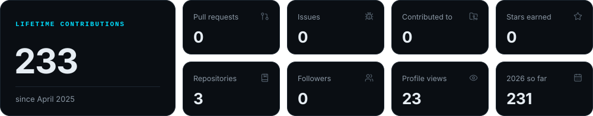
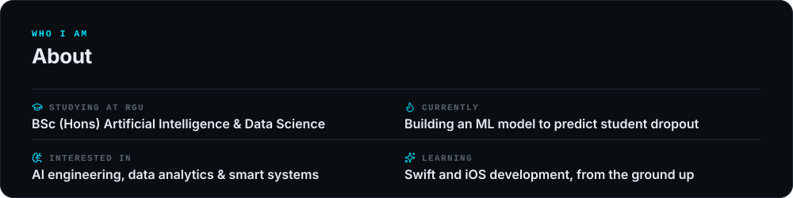
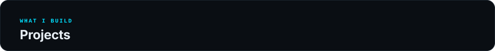
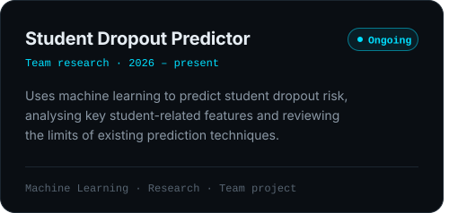
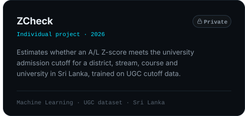
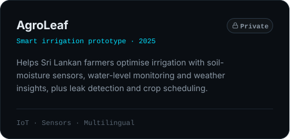
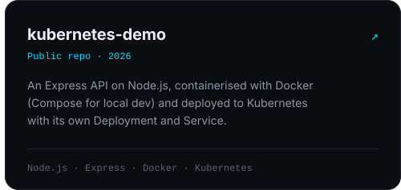
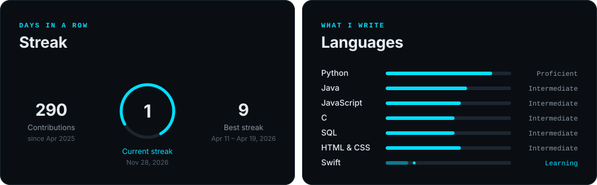
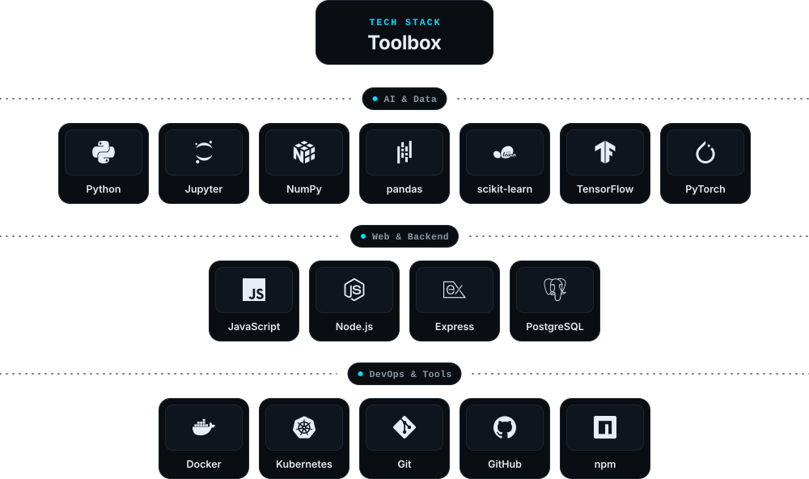

<!-- Artwork in assets/ is drawn by .github/scripts/draw_assets.py (edit its CONTENT block and re-run it).
     The stats, streak and languages panels and the snake are redrawn hourly by .github/workflows/profile-assets.yml
     into the `output` branch; the languages list itself lives in .github/scripts/stat_cards.py (KNOWN_LANGUAGES).
     Every block is its own 
 and 88% wide; blocks in a row carry their own gaps.
     Portfolio: when the site is live, set `live` to True for it in draw_assets.py and wrap its image in a link. -->

<!-- invisible counter that records profile views; the stats above read its total -->

